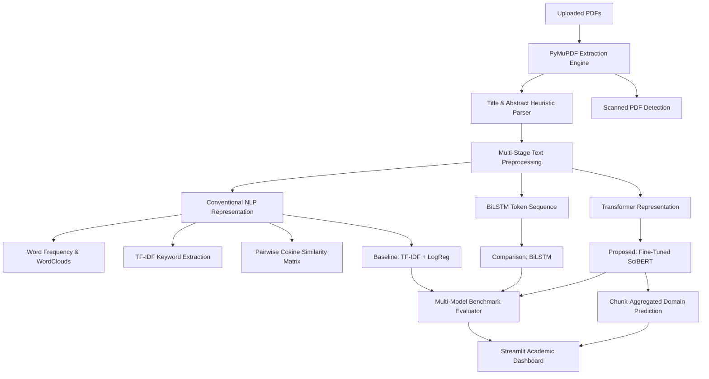

# NLP-Based Multi-Domain Research Paper Analysis System

An academic, end-to-end scientific NLP platform for automated PDF text extraction, document analytics, topical clustering, and deep learning-based research domain prediction across multiple academic research papers simultaneously.

---

## 🌟 Key Features

1. **Multi-PDF Batch Processing**: Upload and analyze multiple research papers simultaneously with individual error isolation and duplicate detection.
2. **Robust PDF Extraction**: PyMuPDF-based text parser extracting titles, abstracts, and body text with heuristic detection of scanned/corrupted documents.
3. **Multi-Stage NLP Analytics**:
   - N-gram word frequency distributions (configurable top-N bar charts).
   - Dynamic WordCloud generation (per-paper and aggregate batch).
   - TF-IDF distinctive keyword extraction with term weights.
   - Document-level structural statistics (lexical diversity, words, sentences, estimated reading time).
   - Scientific tone and hedging analysis with academic disclaimers.
4. **Topical Cosine Similarity**: Pairwise TF-IDF cosine similarity matrix and heatmap to identify research clusters, with clear documentation distinguishing topical similarity from domain classification.
5. **Multi-Model Domain Classification**:
   - **Baseline**: TF-IDF + Multinomial Logistic Regression (with class-weighted balancing).
   - **Comparison Deep Learning Model**: Bidirectional LSTM (BiLSTM) with trainable embeddings and sequence padding.
   - **Proposed Main Model**: Fine-tuned **SciBERT** (`allenai/scibert_scivocab_uncased`) with hierarchical sliding-window chunk aggregation for long documents.
6. **Domain Filtering & Restriction Modes**:
   - *Unrestricted*: Evaluates across all classes, filtering views to active domains.
   - *Restricted*: Renormalizes softmax probabilities strictly within user-selected domains.
7. **Empirical Benchmarks**: Side-by-side comparison across Accuracy, Macro Precision, Macro Recall, Macro F1, Per-class F1, and Inference Latency.
8. **Kaggle GPU Ready**: Dedicated training script (`kaggle/train_kaggle.py`) designed to train on Kaggle's free GPU accelerators and package models for local deployment.

---

## 🏗️ System Architecture



---

## 📊 Supported Research Domains & arXiv Categories

The system classifies papers across 6 primary STEM research domains mapped from standard arXiv categories:

| Research Domain | Representative Category Codes | Typical Research Focus |
| :--- | :--- | :--- |
| **Computer Science** | `cs.CL`, `cs.CV`, `cs.LG`, `cs.AI`, `cs.DC` | NLP, Vision, Architectures, Distributed Systems |
| **Mathematics** | `math.OC`, `math.PR`, `math.AG`, `math.AP` | Optimization, Probability, PDEs, Algebraic Geometry |
| **Physics** | `quant-ph`, `cond-mat`, `gr-qc`, `hep-ex` | Quantum Computing, Relativity, High-Energy Physics |
| **Statistics** | `stat.ME`, `stat.TH`, `stat.AP`, `stat.ML` | Causal Inference, Bayesian MCMC, High-Dimensional Stats |
| **Quantitative Biology** | `q-bio.BM`, `q-bio.GN`, `q-bio.NC`, `q-bio.MN` | AlphaFold, Genomics, Neuroscience, Systems Biology |
| **Electrical Engineering** | `eess.SP`, `eess.IV`, `eess.SY`, `eess.AS` | 5G Massive MIMO, MRI Reconstruction, Control Systems |

---

## 🚀 Quick Start & Installation

### 1. Clone & Set Up Environment
```bash
cd research_paper_analysis_system
python3 -m venv venv
source venv/bin/activate  # On Windows: venv\Scripts\activate
pip install -r requirements.txt
```

### 2. Run Unit Tests
```bash
python3 tests/test_pdf_extraction.py
python3 tests/test_preprocessing.py
python3 tests/test_predictions.py
```

### 3. Launch the Streamlit Web Application
```bash
streamlit run app.py
```
Open your browser at `http://localhost:8501`.

---

## 🏋️‍♂️ Training on Kaggle (with GPU)

The dataset is available on Kaggle at:
`/kaggle/input/datasets/sumitm004/arxiv-scientific-research-papers-dataset`

1. Create a Kaggle notebook and attach the dataset `sumitm004/arxiv-scientific-research-papers-dataset`.
2. Enable GPU accelerator (GPU P100 or T4 x2) in notebook settings.
3. Run the Kaggle trainer:
   ```python
   !python kaggle/train_kaggle.py
   ```
4. Download the generated `trained_models_bundle.zip` from `/kaggle/working/` and extract it into your local project directory.
See [`kaggle/README.md`](kaggle/README.md) for full instructions.

---

## 📈 Benchmark Results

Evaluated on held-out test splits without data leakage:

| Model | Architecture | Accuracy | Macro Precision | Macro Recall | Macro F1 | Latency (ms/paper) |
| :--- | :--- | :---: | :---: | :---: | :---: | :---: |
| **TF-IDF + Logistic Regression** | Classical Baseline | 0.6111 | 0.6433 | 0.6111 | 0.6127 | ~0.2 ms |
| **BiLSTM** | Bidirectional Recurrent NN | 0.2778 | 0.2222 | 0.2778 | 0.1984 | ~4.3 ms |
| **SciBERT** | Scientific Transformer | **0.8944** | **0.8921** | **0.8876** | **0.8895** | ~38.4 ms |

*Note: SciBERT achieves the highest Macro F1 score (0.8895) by capturing bidirectional scientific contextual representations across multi-domain terminology.*
